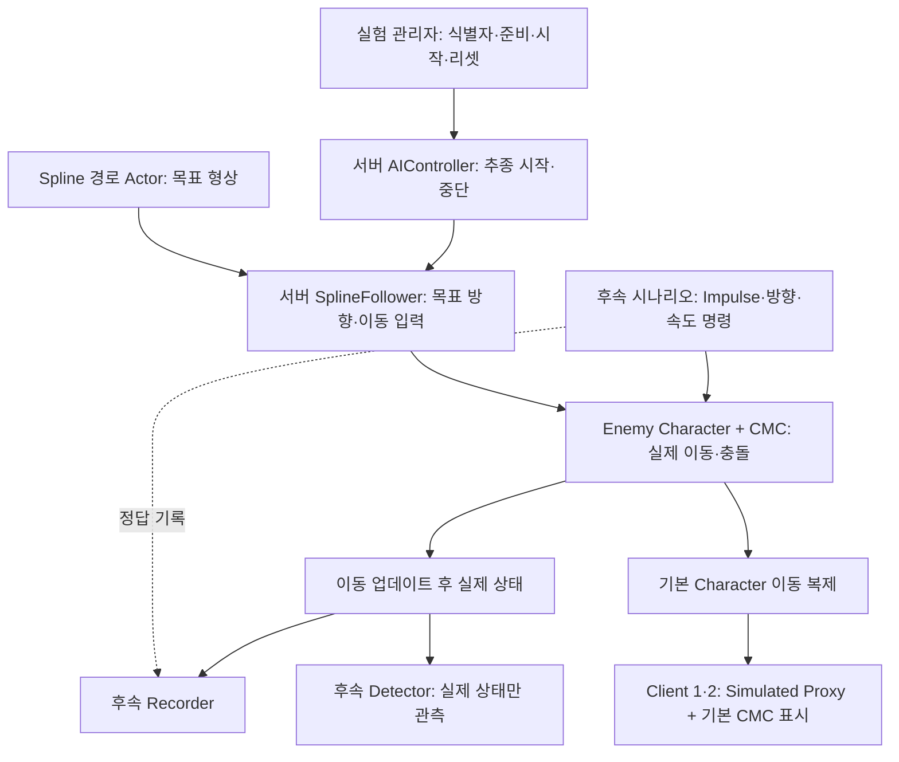

# M1 Spline 기반 서버 AI 이동·복제 전체 개발계획서

> 작성일: 2026-10-11 · 상태: 설계 제안, 구현 전
>
> M1을 바로 개발할 수 있는 상세 계획과 M2~M8 연구 확장 계획을 함께 정의한다. 아래 클래스·설정·시나리오는 `기존`이라고 표시한 항목 외에는 새로 구현할 제안이다.

## 1. 목표와 설계 결정

**서버에서만 Spline을 따라 Enemy의 이동 입력을 생성하고, 실제 위치·속도·충돌·낙하는 기존 Character Movement Component(CMC)가 처리하도록 한다.** 클라이언트에는 기본 Character 이동 복제를 사용한다.

Spline은 재현 가능한 **목표 경로**다. 실제 Enemy의 Capsule을 매 틱 Spline 위치에 강제로 맞추는 방식으로 구현하지 않는다. 이를 통해 같은 이동 시스템 안에서 직선·곡선·급회전·급정지·Impulse·착지·충돌을 연구할 수 있다. Impulse로 경로 밖으로 밀려나는 현상과 추종 제어가 다시 복귀시키는 현상도 그대로 관찰한다.

M1의 성공은 서버 AI 한 개가 두 클라이언트에서 Simulated Proxy로 표시되고, 직선 및 완만한 곡선 경로를 반복 이동하는 것이다. Sharp Movement 검출·전송 개선·시각 예측의 성능 향상은 M2 이후의 검증 대상이다.

### 핵심 원칙

1. 이동 권한은 서버에 있다. 클라이언트는 Spline 추종 입력을 생성하지 않는다.
2. `ACharacter + CMC + Replicate Movement`를 유지한다. M1에서는 기본 Network Smoothing을 사용한다.
3. 목표 경로, 이동 입력, 실제 이동 결과, 사건 정답 로그를 서로 구분한다.
4. Detector에는 Spline 모서리·시나리오 사건·Volume Overlap·Impulse 호출 정보를 전달하지 않는다. 실제 이동 후 위치·속도·Movement Mode만 관측한다.
5. 클라이언트 예측기에 미래 Spline 경로나 예정된 사건을 제공하지 않는다. 경로를 미리 아는 예측은 별도의 연구 조건이어야 한다.
6. 같은 설정은 같은 절차를 재현하는 조건이며 비트 단위 결정론을 보장하지 않는다. 틱 간격·충돌·실제 궤적의 반복 편차를 기록한다.

## 2. 참조 문서와 현재 저장소 상태

설계 기준은 다음 기존 문서다.

| 문서 | 반영 사항 |
|---|---|
| [프로젝트 구성](../PROJECT_OVERVIEW.md) | Core·Net·실험 통합 모듈의 책임과 의존성 |
| [전체 마일스톤 아키텍처](../Architecture/Unreal_Sharp_Movement_마일스톤_구현계획.md) | 서버 권한, 기본 이동 복제 유지, Detector 독립성, M0~M8 |
| [M0 실험 설정](../M0/M0_실험_설정.md) | 기존 RunId·TrialId·Mode와 설정 에셋, 실행 방법 |
| [M1 서버 AI 복제](M1_서버_AI_복제.md) | Enemy·AIController·역할 검증과 완료 기준 |
| [M2 Impulse 재현](../M2/M2_Impulse_재현.md) | 호출 시점과 실제 이동 변화 시점의 분리 |
| [M3 기준선 측정](../M3/M3_CMC_기준선_측정.md) | 서버·Capsule·Mesh 궤적과 첫 수신 전후 오차 |
| [M4 Detector](../M4/M4_Detector.md) | 실제 Δv·Δθ 기반 판정 |
| [M5 전송 정책](../M5/M5_전송_정책.md) | SingleShot·Burst·Snapshot 비교 |
| [M6 시각 예측](../M6/M6_시각_예측.md) | 첫 Snapshot 수신 이후 Mesh만 예측 |
| [M7 견고성](../M7/M7_견고성.md) · [M8 최종 평가](../M8/M8_최종_평가.md) | 연속 사건·충돌·손실·동일 전송 비용 평가 |

2026-10-11 파일·소스 확인 결과:

| 구분 | 확인 내용 | M1에서 할 일 |
|---|---|---|
| 엔진 | `.uproject`는 UE 5.8, 로컬 UE 5.8 설치 존재 | 실제 빌드·실행 단계에서 같은 버전 사용 |
| M0 C++ | ExperimentTypes·Settings·Manager 존재 | 이동 설정, 준비·시작 계약 확장 |
| 실험 식별자 | Manager의 `Identity` 구조체 하나로 RunId·TrialId·Mode 복제 | Enemy 식별자와 시작 상태 추가 |
| M0 설정 | 10/60 Hz, Detector 임계값, Impulse, 예측 시간 존재 | M0 값이 이미 Enemy에 적용된 것으로 간주하지 않기 |
| M0 에셋 | 실험 맵·Manager Blueprint·설정 DataAsset 파일 존재 | Enemy·Spline·관찰 지점 추가, 에디터에서 연결 검증 |
| M0 자동화 | `GenerateM0Assets.py`, `VerifyM0Assets.py` 존재 | 별도 M1 생성·검증 스크립트 추가 |
| M1 | SharpMovement 아래 Enemy·Spline 추종 소스 없음 | 전용 C++ 클래스 및 Blueprint 신규 작성 |
| 모듈 | GE 모듈은 Engine·AIModule을 이미 사용 | Spline·CMC는 GE 모듈에 배치 |
| 기본 맵 | ThirdPerson 기본 맵 유지 | 실험 맵을 명시하여 실행 |
| 실행 타깃 | Game·Editor 타깃 존재, 전용 Server 타깃 없음 | 우선 Editor의 `-server` 실행 사용 |

에셋 파일 존재와 소스 구현은 이번 확인으로 구분했다. 이번 문서 작성에서 빌드·멀티프로세스 실행·에셋 로드 성공을 새로 검증한 것은 아니다. 기존 전체 아키텍처의 2026-10-03 상태표에 있는 “M0 예정” 표기는 이 문서의 최신 확인과 구분한다.

## 3. M1 범위와 이후 확장 범위

| M1 필수 | M1에서 경계만 준비 | 이후 구현 |
|---|---|---|
| 전용 Enemy·서버 AIController | 추종 입력 일시 중단 인터페이스 | M2 Impulse와 외란 구간 |
| Spline 경로 Actor | 시나리오·경로 식별자 | M2~M4 사건 스케줄과 Ground Truth |
| 서버 Spline 추종 Component | 이동 결과 관측 연결점 | M3 Recorder·Metrics |
| 직선·완만한 곡선 이동 | 이동 설정과 전송 모드 분리 | M5 전송 정책 |
| 시작·종료·리셋 계약 | Mesh 표시 확장 연결점 | M6 예측기 |
| 역할·위치·속도·모드 로그 | 반복 실험 상태 초기화 계약 | M7~M8 자동 반복·집계 |

NavMesh·StateTree는 첫 M1 이동에 필수로 사용하지 않는다. 장애물 없는 기준선에서는 Spline 추종 입력을 직접 생성한다. 향후 NavMesh 기반 AI를 비교할 때는 별도 `MovementDriver`로 추가하고, 동일 프레임에 두 제어기가 입력을 내지 않도록 한다.

## 4. 시스템 구조와 책임



| 구성 | 책임 | 권한·복제 |
|---|---|---|
| `ASharpEnemyCharacter` | Capsule·Mesh·CMC, ActorId, 관측 연결점 | 서버 권한, Actor·Movement 복제 |
| `ASharpEnemyAIController` | 서버 possession, 시작·중단 명령 | 서버만 이동 제어, 클라이언트 소유권 부여 안 함 |
| `ASharpSplinePath` | `USplineComponent`, PathId·경로 검증 | 맵 배치 경로는 로컬 에셋, 경로 진행 상태 복제 안 함 |
| `USharpSplineFollowerComponent` | 서버에서 진행도·목표 방향 계산 및 입력 생성 | 클라이언트에서는 비활성 |
| 기존 `ASharpExperimentManager` | 경로·Enemy 연결, Trial 준비·시작·종료 | 서버 제어, 표시용 실행 상태만 복제 |
| 기존 `USharpExperimentSettings` | 네트워크·Detector·예측 설정 | 서버의 적용 값으로 실행 manifest 기록 |
| `USharpMovementScenario` | 후속 속도·회전·외란 설정 DataAsset | M2 이후, 서버만 사건 실행 |

Spline이 클라이언트 맵에 존재해도 이동과 예측 코드에서 접근하지 않는다. 클라이언트에서 경로 선을 그리는 기능은 디버그 전용으로 한정한다. 런타임 경로 변경·Spline Control Point 복제는 M1 범위 밖이다.

Core에는 이후 순수 판정·계산만, Net에는 이후 Snapshot 계약만 둔다. Spline Actor와 CMC를 Core로 옮기지 않는다. M1에 새 Net 전송 타입을 미리 만들지 않는다.

## 5. Spline 추종 상세 설계

### 5.1 경로 데이터

`ASharpSplinePath`는 경로 길이·Control Point·Point Type·Closed Loop 설정과 고유 `PathId`를 제공한다. 기본 경로는 열린 평면 Spline이다. 맵 경로의 위치·회전·스케일은 실행 중 고정한다.

거리는 cm, 시간은 초, 속도는 cm/s, 각도는 도로 기록한다. 거리 기반 API의 샘플은 World 좌표계로 통일한다. Input Key를 물리 거리로 취급하지 않는다. 재매개화 정밀도, Point Type, Tangent 설정, 경로 Transform을 manifest에 남긴다.

경로는 **바닥 위 목표 선**으로 정의한다. 실제 Capsule 중심 높이는 반높이와 바닥 접촉 결과로 결정한다. Walking에서 경로 오차와 추종 방향은 XY 평면으로 계산하고 Z축 위치를 Spline에 맞추지 않는다. 입체 경로·비행은 Movement Mode를 포함하는 후속 별도 시나리오다.

### 5.2 진행도와 입력

M1은 시간에 따라 가상 목표점을 전진시키는 방식보다 **실제 위치에서 구한 진행도 + 제한된 look-ahead 추종**을 기본으로 한다. 충돌이나 Impulse로 이동이 늦어졌을 때 가상 목표가 계속 멀어지는 것을 피하기 위한 설계 선택이다.

매 서버 이동 프레임의 순서는 다음과 같다.

1. 직전 CMC 결과 위치를 XY 기준 경로에 투영하여 `s_actual` 후보를 구한다.
2. 이전 진행도·진행 방향·최대 허용 이동 거리를 기준으로 후보를 제한한다.
3. `s_target = clamp(s_actual + TravelSign × LookAheadDistance, 0, PathLength)`를 계산한다.
4. 실제 위치에서 목표점으로 향하는 평면 방향을 구하고, 방향이 유효할 때 이동 입력을 생성한다.
5. `TargetSpeed`는 CMC의 목표 이동 속도 설정으로 적용한다. Input Scale을 곧바로 cm/s로 해석하지 않는다.
6. CMC가 입력·가속·마찰·중력·충돌에 따라 이동한다.
7. 이동 업데이트 이후 실제 위치·속도·Movement Mode와 진행도·경로 오차를 관측한다.

`AddMovementInput()`을 사용하며 `bForce`로 입력 무시 상태를 우회하지 않는다. Controller possession과 입력 허용 상태를 먼저 확인한다. Character는 이동 입력을 처리할 수 있다는 것이 API의 역할이다. 원하는 궤적을 얻는 추종 제어·look-ahead·속도 설정은 프로젝트에서 별도로 설계한다. [Epic AddMovementInput](https://dev.epicgames.com/documentation/en-us/unreal-engine/API/Runtime/Engine/APawn/AddMovementInput).

최근접 거리의 글로벌 검색은 U자·교차 경로에서 다른 구간으로 튈 수 있다. M1 기본 경로는 교차·루프가 없도록 제한하고, 진행도와 이전 구간을 반드시 보관한다. M7에서는 이전 구간 주변의 제한된 탐색과 펼친 루프 진행도를 구현한다. 미래 급회전 연구에서는 look-ahead가 모서리를 미리 깎는 효과도 통제해야 한다.

### 5.3 Tick과 관측 순서

서버 Follower의 입력 생성이 CMC 이동보다 먼저 실행되도록 Tick prerequisite를 설정하고, 실제 순서를 프레임 번호로 검증한다. Character Actor Tick과 CMC는 기존 선후 관계를 가질 수 있으므로 Actor Tick에 역방향 의존성을 무조건 추가하지 않는다. 별도 Follower Component와 CMC 사이의 의존성을 확인하여 순환을 피한다.

결과 수집은 `ACharacter::OnCharacterMovementUpdated` 연결점을 사용한다. 이 지점에서 제공되는 이전 위치·이전 속도와 현재 CMC 상태를 읽는다. 독립적인 임의 Actor Tick에서 “Impulse 적용 후 상태”를 추정하지 않는다. 필요하면 UE 5.8의 이동 코드와 delegate 호출 위치를 대조한다.

### 5.4 정지·끝점·실패 처리

- 정상 끝점에서는 잔여 거리 기반 감속 구간을 사용한다. 끝점 허용 반경과 실제 속도 허용치를 모두 만족하면 `Completed`로 전환한다.
- 입력이 없을 때 CMC의 제동 설정에 따라 감속한다. 정상 종료에서 매 틱 속도를 0으로 덮어쓰지 않는다.
- 길이 0, 중복점에 의한 방향 불능, 미연결 경로·설정, possession 실패는 오류로 기록하고 Trial을 시작하지 않는다.
- 진행이 일정 시간 없으면 `Blocked`로 종료 또는 일시 중단한다. 장애물을 통과하도록 좌표를 보정하지 않는다.
- M1의 완료 방식은 열린 경로에서 정지다. 왕복·루프는 별도 설정으로 이후 추가한다.
- 시작점 배치와 Trial 리셋에는 서버 teleport를 사용할 수 있다. 이는 실험 준비 작업이며 측정 구간에서는 제외한다.

## 6. 다양한 Sharp Movement를 위한 실험 모델

연구 조건은 네트워크 `Mode`와 별도로 관리한다. `Default`, `Burst` 등의 기존 enum에 급회전·급정지 같은 시나리오 이름을 섞지 않는다.

```text
하나의 실험 조건
  = PathId / PathRevision
  + ScenarioId / ScenarioRevision
  + MovementProfileId / ControlPolicy
  + Replication Mode / BaselineProfile
  + NetworkProfile / TrialId
```

### 6.1 시나리오 매트릭스

| 시나리오 | 발생 방식 | 정답과 관측 | 도입 단계 |
|---|---|---|---|
| 직선 등속 | 직선 Spline·일정 목표 속도 | 가속 구간 이후 실제 속도 안정 | M1 필수 |
| 완만한 회전 | 연속 Tangent의 곡선 Spline | 정상 Δθ·곡률·경로 오차 | M1 필수 |
| 급회전 | 선형 구간 코너 + 해당 거리에서 목표 방향 전환 | 명령 시각과 실제 속도 방향 변화 분리 | M2 확장, M4 평가 |
| 정상 감속 | 거리 기반 속도 프로파일 | 정상 제동의 실제 Δv | M2 확장 |
| 급정지 | 사건 시 목표 속도 0 또는 명시적 hard stop | 두 정지 방식을 별도 조건으로 기록 | M2 확장 |
| 급가속·반전 | 속도 목표 변경·TravelSign 변경 | 실제 가속 시간·반전 지연 | M2 확장 |
| 측면·전방·후방 Impulse | 서버 Volume에서 CMC AddImpulse | 호출과 실제 변화 시각·Movement Mode | M2 필수 |
| 상향 Impulse·착지 | 수직 외란 및 CMC 낙하 | Falling 진입·착지 실제 시각 | M2·M7 |
| 연속 복합 사건 | 거리/시간 기반 사건 목록 | 여러 사건 ID와 간격 | M7 |
| 충돌·다중 AI | 장애물·여러 Enemy | 충돌 이후 실제 궤적·연결별 비용 | M7·M8 |

**Spline이 매끄럽다는 사실은 실제 이동에 급변이 없다는 뜻이 아니다.** 반대로 선형 Spline에 모서리를 만들었다고 실제 Velocity가 즉시 꺾이는 것도 아니다. CMC 가속·속도·look-ahead·제동과 회전 설정에 따라 결과가 달라진다. Sharp Movement 여부와 세기는 실제 `Δv`, `Δθ`, 발생 시간으로 판정한다.

시각적 Actor 회전과 이동 Velocity 방향도 별도 기록한다. 90도 급회전은 먼저 “목표 방향의 90도 전환”으로 정의하고, 실제 이동이 어느 시간에 몇 도 변했는지는 측정 결과로 보고한다. CMC 속도를 직접 바꾸는 회전은 별도 강제 사건 조건으로 분리한다.

### 6.2 사건 정의와 발동

M2 이후 `FSharpScenarioEvent`를 도입한다. 제안 필드는 `EventId`, `EventType`, `TriggerType`, `TriggerDistance` 또는 `TriggerElapsedTime`, `Payload`, `ControlPolicy`, `HoldSeconds`다. EventId는 시나리오 정답 식별자이고, Detector의 SequenceId와 별개다.

거리 사건은 `s_prev < s_trigger <= s_now` 등의 통과 판정을 사용한다. 정확한 거리 일치 비교는 하지 않는다. 한 틱에 여러 사건을 넘으면 사전 정의된 거리·우선순위 순으로 실행하고, 해당 Trial에서 발동한 EventId를 보관하여 중복을 막는다. 역방향과 루프의 기준은 해당 기능 도입 시 명시한다.

첫 Impulse는 기존 M2 계획대로 Volume Overlap으로 만든다. 거리 기반 스케줄러는 급정지·급회전 등을 추가할 때 도입한다. 두 장치 모두 Detector에 사건 정보를 전달하지 않는다.

### 6.3 Impulse 이후 추종 제어

| ControlPolicy | 동작 | 연구 목적 |
|---|---|---|
| `ContinueFollow` | 외란 뒤에도 기존 추종 입력 유지 | 실제 AI가 즉시 경로로 돌아가려는 조건 |
| `SuspendInputForWindow` | 정해진 시간 신규 입력 중단, 기존 속도·중력·마찰 유지 | 추종 입력 개입을 줄인 외란 관찰 |
| `ResumeWithRamp` | 중단 뒤 입력·목표 속도를 일정 시간에 걸쳐 복귀 | 복귀 제어 자체의 급변 분리 |

첫 외란 기준선은 `SuspendInputForWindow`로 만들고 `ContinueFollow`를 후속 비교한다. M1에서는 중단·재개 인터페이스까지만 준비한다. 단순 입력 중단은 CMC의 물리 영향을 없애지 않으며, 외란 구간에 `StopMovementImmediately()`를 호출하면 Impulse 속도 자체를 없앨 수 있으므로 사용하지 않는다.

복귀 때는 실제 위치에서 진행도를 다시 구한다. 원래 시간표에 맞춰 위치를 강제로 되돌리지 않는다. Falling 중 평면 입력 허용 여부, CMC AirControl, 복귀 지연을 명시적으로 고정한다. “외란에 의한 급변”과 “복귀 입력에 의한 급변”은 Ground Truth에서 분리한다.

## 7. 설정·식별자·로그 계약

### 7.1 M1 이동 설정 제안

처음에는 Follower의 편집 가능한 설정 구조체를 사용하고, 시나리오가 늘면 이동 설정 DataAsset으로 추출한다. 아래 수치는 초기 검증용 제안이며 측정 후 조정한다.

| 필드 | 초기 제안 | 의미 |
|---|---|---|
| `TargetSpeed` | 300 cm/s | 기준 목표 이동 속도 |
| `LookAheadDistance` | 100 cm | 추종 목표의 전방 거리 |
| `StartDelaySeconds` | 준비 완료 후 1 s | 관측 시작 전 대기 |
| `AcceptanceRadius` | 30 cm | 끝점 도달 위치 허용치 |
| `StopSpeedTolerance` | 5 cm/s | 완료 판정 속도 허용치 |
| `EndSlowdownDistance` | 200 cm | 정상 종료 감속 구간 |
| `BlockedTimeoutSeconds` | 3 s | 진행 없음 판정 시간 |
| `TravelSign` | +1 | 진행 방향 |
| `ControlPolicy` | M1은 ContinueFollow | 이후 외란 구간 제어 정책 |

`MaxAcceleration`, `BrakingDecelerationWalking`, `GroundFriction`, `BrakingFrictionFactor`, `RotationRate`, `bOrientRotationToMovement`, `AirControl`, `GravityScale`은 실제 적용 값을 시작 로그에 반드시 포함한다. Blueprint의 임의 기본값으로 비교 조건이 달라지지 않도록 한다. 목표 속도만 같아도 이 값들이 다르면 Sharp Movement가 달라질 수 있다.

### 7.2 기본 복제 조건

기존 `Default` 의미를 보존하기 위해 두 기준선 프로파일을 구분한다.

- `EngineDefault`: Enemy·CMC의 엔진 기본 복제 빈도·smoothing 값을 로그에 남기고 변경하지 않는다.
- `ControlledLowRate`: M0의 평상시 값 10 Hz 등을 모든 비교군의 공통 평상시 조건으로 적용한다. 이를 엔진 기본값이라고 부르지 않는다.

M1은 먼저 EngineDefault로 권한과 이동 복제를 확인한다. 낮은 빈도의 문제 재현은 M3에서 별도 프로파일로 수행한다. 실제 `NetUpdateFrequency`, `MinNetUpdateFrequency`, adaptive 관련 설정을 기록한다. 설정 Hz는 실제 패킷 수와 같다고 가정하지 않는다.

M1의 단일 Enemy는 `bAlwaysRelevant=true`, `DORM_Never`, `bOnlyRelevantToOwner=false`로 제한된 테스트에서 계속 관측 가능하게 한다. 이 설정은 연구 초기의 조건이며 다중 AI 비용 평가에서는 relevancy 조건을 다시 정한다. 이동 중 매 틱 `ForceNetUpdate()`를 호출하지 않는다. 기존 Manager의 초기 Identity 갱신 요청은 Enemy의 사건 기반 전송 정책과 구분한다.

### 7.3 로그와 클라이언트 정보

공통 키는 `RunId`, `TrialId`, `ActorId`, `Mode`다. M1에 `ActorId`를 서버 지정 값으로 추가하여 Enemy 초기 메타데이터로 복제한다. 프로세스마다 다른 객체 이름을 식별자로 쓰지 않는다.

로그에는 `PathId`, `ScenarioId`, 설정 Revision, Role, NetMode, LocalWorldTime, 추정 ServerWorldTime, FrameNumber, DeltaSeconds, 실제 위치·속도·Movement Mode, Capsule·Mesh 위치를 기록할 수 있는 연결점을 둔다. 서버 추종 로그에는 `s_actual`, `s_target`, 경로 오차, 추종 상태, 입력 방향을 추가한다. M1은 역할 로그와 낮은 빈도 진단으로 시작하고 매 이동 틱 데이터 기록은 M3에서 구현한다.

`Settings`는 현재 Manager의 복제 프로퍼티가 아니다. 같은 맵·에셋을 로드한 클라이언트 로그를 서버 명령줄에서 실제 적용한 설정의 증거로 취급하지 않는다. 서버 manifest를 분석 기준으로 사용하고 클라이언트에는 표시·로그 결합에 필요한 식별자와 Trial 상태만 전달한다. 관리자 Identity와 Enemy 메타데이터의 수신 순서는 가정하지 않고, 필요한 값이 모두 준비된 뒤 결합 로그를 작성한다.

사건 단계부터 `EventId`, `DetectorSequenceId`, `CommandTime`, `AppliedMovementTime`, `PredictionType` 등을 추가한다. 정답 EventId와 DetectorSequenceId는 분석 시 시각·Actor를 통해 대응시키며 동일 번호가 되도록 연결하지 않는다.

## 8. 시작·종료·리셋 수명주기

상태는 `Preparing → Ready → Running → Completed`, 오류 시 `Failed`로 정의한다.

1. 서버 Manager가 Identity·설정을 확정한다.
2. PathId 중복·길이·Enemy 수·CMC 설정·Controller possession을 검증한다.
3. 서버가 Enemy를 한 번만 생성하거나 맵에 배치된 Enemy 한 개를 등록한다. M1은 맵 배치를 기본으로 하고 클라이언트의 별도 spawn을 금지한다.
4. 서버가 Enemy를 시작점에 배치하고 입력·속도·이전 진행도·완료 상태를 초기화한다.
5. Client 2개 접속을 확인하고 수동 시작하거나, 후속 자동화에서 준비 신호를 받아 시작한다. 단순 고정 지연만으로 클라이언트 준비 완료를 보장하지 않는다.
6. 서버 기준 시작 시각을 확정하고 추종을 시작한다. M1은 명시적 시작 명령으로 반복 실행할 수 있게 한다.
7. 끝점 또는 실패에서 입력을 종료하고 Trial 결과를 기록한다.
8. 리셋 시 TrialId를 갱신하고 이전 상태를 모두 비운 뒤 다음 Trial을 준비한다.

준비 RPC가 필요해지면 클라이언트가 소유한 PlayerController에서 보내도록 한다. 클라이언트가 소유하지 않은 Manager나 Enemy에서 서버 RPC가 동작한다고 가정하지 않는다. M1 수동 시작만으로도 완료할 수 있으며 준비 RPC는 자동 반복 단계에 구현한다.

후속 단계의 리셋에는 Volume 발동 집합, 사건 발동 집합, Detector 이전 샘플·Risk·쿨다운, Snapshot 순서 상태, Predictor offset·타이머, Recorder 버퍼도 포함한다. Trial 시작 teleport와 초기 가속은 Sharp Movement 평가 구간에서 제외한다. 리셋된 Trial의 늦은 Snapshot을 버릴 수 있도록 M5에서 Trial 식별자·Sequence 계약을 결정한다.

## 9. 파일·에셋별 작업 계획

아래 경로는 저장소 루트 기준이다.

| 경로 | 작업 | 단계 |
|---|---|---|
| `Source/GE_AIReplication/SharpMovement/Enemy/SharpEnemyCharacter.h/.cpp` | ACharacter, 복제·ActorId·관측 연결점 | M1 신규 |
| `Source/GE_AIReplication/SharpMovement/Enemy/SharpEnemyAIController.h/.cpp` | 서버 possession·추종 명령 | M1 신규 |
| `Source/GE_AIReplication/SharpMovement/Movement/SharpSplineFollowerComponent.h/.cpp` | 진행도·입력·완료·중단·재개 | M1 신규 |
| `Source/GE_AIReplication/SharpMovement/Movement/SharpSplineMovementTypes.h` | 추종 상태·이동 설정 구조체 | M1 신규 |
| `Source/GE_AIReplication/SharpMovement/Scenario/SharpSplinePath.h/.cpp` | Spline 경로·PathId·검증 | M1 신규 |
| `Source/GE_AIReplication/SharpMovement/Experiment/SharpExperimentManager.h/.cpp` | Enemy·경로 연결, Trial 제어 | 기존 확장 |
| `Source/GE_AIReplication/SharpMovement/Experiment/SharpExperimentTypes.h` | Trial 상태·식별 메타데이터 | 기존 확장 |
| `Source/GE_AIReplication/SharpMovement/Experiment/SharpExperimentSettings.h/.cpp` | 실제 설정 검증·로그 보강 | 기존 확장, 기존 Mode 유지 |
| `Content/SharpMovementExperiment/Blueprints/BP_SharpEnemy.uasset` | 표시 Mesh·CMC·Controller 설정 | M1 신규 |
| `Content/SharpMovementExperiment/Blueprints/BP_SharpSplinePath.uasset` | 경로 편집용 Blueprint | M1 신규 |
| `Content/SharpMovementExperiment/Maps/SharpMovementExperiment.umap` | 직선·곡선 경로, Enemy, 관찰 지점 | 기존 확장 |
| `Scripts/GenerateM1Assets.py` | 누락 에셋 생성·참조 연결, 수동 경로 편집 보존 | M1 신규 |
| `Scripts/VerifyM1Assets.py` | 클래스·설정·Manager/Enemy/Path 연결 검증 | M1 신규 |
| `Source/GE_AIReplication/SharpMovement/Scenario/SharpMovementScenario.h/.cpp` | 시나리오 DataAsset·사건 설정 | M2 이후 신규 |
| `Source/GE_AIReplication/SharpMovement/Scenario/SharpScenarioRunnerComponent.h/.cpp` | 사건 통과 판정·중복 방지 | M2 이후 신규 |
| `Content/SharpMovementExperiment/Data/Scenarios/` | Sharp Movement별 설정 에셋 | M2 이후 신규 |

실제 이동·측정·Detector·Net·Prediction의 후속 파일은 기존 M2~M8 문서의 경로를 유지한다. M1 생성 스크립트는 기존 M0 에셋을 재생성하거나 사용자 Spline 편집을 덮어쓰지 않는다. 에셋 변경 전 기존 LFS·잠금 규칙을 따른다.

## 10. M1 구현 순서와 검증 게이트

| 순서 | 구현 작업 | 다음 단계로 넘어가는 증거 |
|---|---|---|
| 1 | 현재 M0 에셋 로드·설정 연결·로그 재확인 | 서버와 두 클라이언트의 Identity 일치 |
| 2 | Enemy·AIController 추가, 서버 possession·기본 복제 | 두 클라이언트에 동일 ActorId Enemy 한 개씩 표시 |
| 3 | SplinePath와 Follower 추가 | 직선에서 CMC 입력 이동, Tick 선후 관계 확인 |
| 4 | 실제 진행도·끝점 감속·중단·리셋 | 시작→이동→정지→재시작 성공 |
| 5 | 곡선 경로와 설정 검증 추가 | 정상 회전·경로 오차 관측, 오류 설정 시작 차단 |
| 6 | 실험 맵·Blueprint·생성/검증 스크립트 | 누락 생성 및 반복 실행에 에셋 중복 없음 |
| 7 | 별도 서버 프로세스 + Client 2개 검증 | Authority/Simulated Proxy, 클라이언트 입력 호출 0회 |
| 8 | 재현 실행 방법과 결과 문서화 | 다른 실행에서도 동일 조건·절차 재현 |

### 최소 검증 시나리오

| 항목 | 조건 | 합격 기준 |
|---|---|---|
| 권한 | Dedicated Server 1 + Client 2 | 서버 Authority, 각 Client Simulated Proxy; Enemy Autonomous Proxy 없음 |
| 직선 | 열린 직선 1,200 cm, 목표 속도 300 cm/s | 초기 가속·말단 감속 제외 안정 이동, 정상 완료 |
| 곡선 | 바닥 범위 내 완만한 곡선 | 강제 위치 보정 없이 추종, 오류·비정상 경로 도약 없음 |
| 끝점 | 감속 구간 200 cm | 위치 30 cm 이내 및 속도 5 cm/s 이하에서 완료 |
| 중단·재개 | 실행 도중 입력 중단 후 재개 | 중단 중 신규 입력 0, 실제 위치에서 추종 재개 |
| 리셋 | 같은 조건 3회 | Actor 중복·이전 진행도·완료 상태 누적 없음 |
| 오류 설정 | 길이 0·미연결 경로 | 이동을 시작하지 않고 원인 로그 출력 |
| 늦은 접속 | 실행 중 두 번째 Client 접속 | 현재 서버 Enemy 표시, 로컬 독립 추종 없음 |
| 연속 관측 | 최소 30초 관찰 구간 | dormancy/relevancy로 갱신 대상에서 사라지지 않음 |

직선 안정 구간의 초기 허용 목표는 속도 오차 10% 이내, 평면 경로 오차 30 cm 이내다. 이 값은 프로젝트가 정한 검증 목표이며 엔진 보장값이 아니다. 곡선에는 곡률별 허용 오차를 결과와 함께 정하고, M1 종료 시 실제 사용한 경로·설정으로 확정한다. 클라이언트 위치 오차는 M3에서 정량 평가하므로 M1에서 서버와 클라이언트가 매 프레임 같은 위치일 것을 요구하지 않는다.

우선 M0 문서의 `UnrealEditor.exe <project> <experiment-map> -server -game` 방식으로 검증한다. PIE 검증만으로 멀티프로세스 결과를 대체하지 않는다. 패키징된 Dedicated Server는 전용 Server 타깃과 엔진 빌드 조건을 별도 확인한 뒤 수행한다.

### M1 완료 체크리스트

- [ ] Enemy가 서버 한 곳에서만 제어되고 두 Client에 복제된다.
- [ ] 직선·완만한 곡선이 같은 Follower 구조로 동작한다.
- [ ] 측정 구간에서 매 틱 Capsule 위치·Velocity를 강제로 덮어쓰지 않는다.
- [ ] 클라이언트에서 Follower 입력·시나리오 실행이 비활성임을 로그로 확인했다.
- [ ] possession·Tick 순서·실제 CMC 설정을 확인했다.
- [ ] 시작·정지·리셋·잘못된 경로의 처리 결과가 기록되었다.
- [ ] EngineDefault와 후속 ControlledLowRate 기준선이 구분되었다.
- [ ] 빌드·에셋 검증·멀티프로세스 실행 결과와 재현 방법이 남았다.

## 11. M2~M8 전체 연구 개발 로드맵

| 단계 | Spline 기반 확장 작업 | 산출물·판단 게이트 |
|---|---|---|
| M2 | 직선 외란 기준선, 기존 Impulse Volume, 입력 중단/계속 비교; 이후 급정지·급회전 스케줄 | 사건 명령·호출·실제 적용 로그, 실제 Velocity 급변 재현 |
| M3 | 서버 궤적·Client Capsule·Mesh 기록, 직선/곡선 정상 대조군, 전송 프로파일 고정 | 첫 수신 전후 오차·보정·비용; 문제 미미하면 조건 재설계 |
| M4 | 이동 결과만 Detector에 입력, 회전·정지·Impulse 검출과 정상 곡선 오탐 평가 | Precision/Recall·탐지 지연·사건 종류별 미탐·오탐 |
| M5 | 같은 Path·Scenario·ControlPolicy에 SingleShot/Burst/EventOnly 적용 | 첫 수신 시각·실제 bytes/s, 일회 전송과 후속 전송의 기여 분리 |
| M6 | 미래 Spline 없는 PostVelocity 기반 Mesh 단기 예측 | EventOnly와 동일 전송에서 첫 수신 이후 개선 검증 |
| M7 | 연속 사건·반전·루프·충돌·착지·손실·여러 AI, 복귀 제어 안정화 | 늦은 사건 무시·예측 만료·기본 복제로 복구하는 증거 |
| M8 | Path·Scenario·네트워크·AI 수·모드별 반복 실험 | 동일 실측 예산 비교, 평균·worst case·변동 폭, 최종 결론 |

M6은 구현량을 무조건 늘리는 단계가 아니다. M3~M5에서 첫 수신 이후 문제가 작으면 SingleShot/Burst 중심 결론으로 마무리할 수 있다는 기존 판단 게이트를 유지한다. 곡선에서 등속 예측이 나빠지는 경우 예측 시간 단축·만료 조건을 먼저 검토한다. 미래 경로 정보를 추가하여 평가 조건을 바꾸지 않는다.

최종 실험은 다음 축을 독립적으로 고정하거나 변화시킨다.

- 이동: 경로 형상, 목표 속도, 실제 급변 크기, CMC 가속·제동, ControlPolicy.
- 사건: 종류, 방향, 강도, 발생 거리/시간, 연속 간격.
- 통신: 평상시 복제 프로파일, Mode, 지연·지터·손실, 실제 전송량.
- 규모: AI 수, relevancy 조건, 연결 수.

튜닝 Trial과 평가 Trial을 분리한다. 예측 성능의 정답은 Spline상의 이상적인 점이 아니라 **동일 서버 시각의 실제 서버 궤적**이다. Spline 경로 오차는 추종 제어 품질을 평가하는 별도 지표다. 공통 시간은 GameState의 서버 시간 추정으로 맞추되 동기화 오차도 고려하여 보간한다.

## 12. 주요 설계 위험과 대응

| 위험 | 대응 및 확인 방법 |
|---|---|
| Spline 좌표 강제 적용으로 Impulse가 사라짐 | 위치는 CMC가 결정, 측정 구간의 teleport·직접 Velocity 쓰기 금지 |
| 추종 입력이 외란을 즉시 지워 실험 조건이 달라짐 | ControlPolicy 분리, 외란 후 실제 속도와 복귀 시각 기록 |
| look-ahead가 코너를 미리 돌아 급회전이 완만해짐 | look-ahead 고정·로그, 코너 사건의 명령 방향 전환과 실제 Δθ 측정 |
| 최근접점이 다른 경로 구간으로 도약 | M1 교차 경로 제한, 진행도 검증; M7 구간 제한 탐색 |
| Spline 높이와 Capsule 중심의 차이 | 바닥 목표선·XY 오차 사용, Z는 CMC 바닥·낙하 결과 |
| 초기 배치·리셋이 Sharp 사건으로 검출 | 준비/측정 상태 구분, Detector 이력 초기화, 평가 구간 제외 |
| 클라이언트가 미래 경로를 이용해 성능이 과대평가됨 | 예측 입력에 Path 참조·Scenario 목록 금지, 정답은 사후 분석만 사용 |
| 기본 Smoothing과 예측 Offset이 중복 적용 | M1 기본 Smoothing 보존, M6 통합 단계에서 한 경로로 제어 |
| 설정 Hz를 실제 전송량으로 오인 | Networking Insights 및 연결별 실측 비용으로 판단 |
| 파일 존재를 런타임 완료로 오인 | 빌드·에셋 로드·서버/Client 실행을 별도 완료 증거로 기록 |

## 13. 공식 근거와 UE 5.8 구현 확인 지점

이 문서의 추종 알고리즘·초기 수치·수명주기는 프로젝트 설계 제안이다. 엔진의 역할별 이동 및 API 근거는 다음 공식 문서다.

- [CMC 네트워크 이동](https://dev.epicgames.com/documentation/unreal-engine/understanding-networked-movement-in-the-character-movement-component-for-unreal-engine): Authority·Simulated Proxy 이동과 기본 복제·Network Smoothing의 관계.
- [USplineComponent API](https://dev.epicgames.com/documentation/unreal-engine/API/Runtime/Engine/USplineComponent): 거리 기반 위치·방향 조회와 경로 편집 기능.
- [APawn::AddMovementInput](https://dev.epicgames.com/documentation/en-us/unreal-engine/API/Runtime/Engine/APawn/AddMovementInput): World 방향 입력 및 Character의 입력 처리.
- [UCharacterMovementComponent API](https://dev.epicgames.com/documentation/en-us/unreal-engine/API/Runtime/Engine/UCharacterMovementComponent): 실제 이동·속도·가속·제동 설정의 구현 확인.
- [Actor Role](https://dev.epicgames.com/documentation/unreal-engine/actor-role-and-remote-role-in-unreal-engine): 역할 검증 기준.

로컬 UE 5.8 헤더에서 `GetLocationAtDistanceAlongSpline`, `GetDirectionAtDistanceAlongSpline`, `GetDistanceAlongSplineAtLocation`, `FindInputKeyClosestToWorldLocation`, `GetDistanceAlongSplineAtSplineInputKey`와 `OnCharacterMovementUpdated` 존재를 확인했다. 실제 C++ 구현 시 좌표계·입력 키/거리 변환·delegate signature·Tick prerequisite를 해당 버전 코드와 대조한다. 기본 최근접 API의 존재가 교차 경로 추종 안정성을 보장하지는 않는다.

M1 종료 산출물은 전용 Enemy·Spline 추종 코드, 직선/곡선 실험 장면, 두 Client의 역할 로그, 반복 실행 절차, 사용 설정 및 확인된 한계다. 이후 단계는 이 동일한 이동 기반 위에 사건 발생·관측·전송·시각 예측을 순서대로 추가한다.
